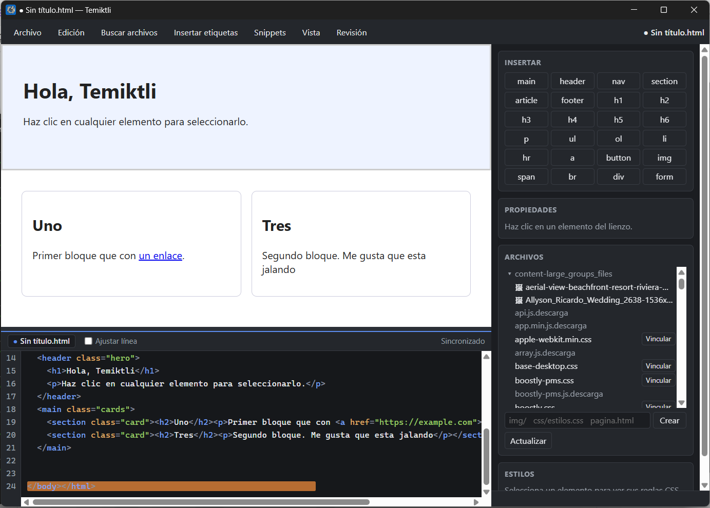

# Temiktli

Editor visual de HTML y CSS para escritorio (Windows, macOS y Linux). Código abierto bajo licencia MIT.


## Descargar

Los instaladores están en [Releases](https://github.com/vgarcias/temiktli/releases). Elige el de tu sistema; las instrucciones de cada uno están justo debajo.

> Los instaladores **no están firmados**. Tu sistema mostrará un aviso la primera vez; es normal en proyectos de código abierto sin certificado de pago.

### Windows
1. Descarga `Temiktli-<versión>-windows-x64-setup.exe` y ábrelo.
2. SmartScreen dirá «Windows protegió su PC»: pulsa **Más información** → **Ejecutar de todas formas**.
3. Windows 11 ya incluye WebView2. En Windows 10 sin él, instala el [runtime de WebView2](https://developer.microsoft.com/microsoft-edge/webview2/).

### macOS
1. Descarga el `.dmg` de tu Mac (`arm64` para Apple Silicon, `x64` para Intel) y arrastra Temiktli a **Aplicaciones**.
2. La primera vez, **clic derecho → Abrir**.
3. Si macOS dice que la aplicación está «dañada» o no se puede verificar:

   ```
   xattr -cr /Applications/Temiktli.app
   ```

### Linux
- Debian, Ubuntu y derivadas: `sudo apt install ./Temiktli-<versión>-linux-x64.deb`.
- Otras distribuciones (si el AppImage está en la release): `chmod +x Temiktli-<versión>-linux-x64.AppImage && ./Temiktli-<versión>-linux-x64.AppImage`. Necesita WebKitGTK 4.1 instalado.

### Verificar la descarga
Descarga también `SHA256SUMS.txt` y ejecuta `sha256sum -c SHA256SUMS.txt --ignore-missing` (en macOS, `shasum -a 256 -c SHA256SUMS.txt`).

## Captura de pantalla



## Tus datos

Temiktli guarda tus snippets (`snippets.json`) y tu configuración (`config.json`) aquí. Se conservan al actualizar o desinstalar:

| Sistema | Carpeta |
|---|---|
| Windows | `%APPDATA%\Temiktli` |
| macOS | `~/Library/Application Support/Temiktli` |
| Linux | `$XDG_CONFIG_HOME/Temiktli` o `~/.config/Temiktli` |

## Actualizar

Descarga el instalador de la versión nueva e instálalo encima. No hay actualización automática.

## Idiomas

La interfaz está en inglés, español, francés, portugués, alemán, italiano y polaco. Usa el idioma del sistema; se cambia en **Vista → Idioma**.

## Compilar desde el código

Necesitas [Rust](https://rustup.rs). En Linux, además: `libwebkit2gtk-4.1-dev` y `libgtk-3-dev`.

```
cargo run -p temiktli-shell --release
cargo test --workspace
```

Para generar un instalador local: `cargo install cargo-packager --locked`, y desde `crates/temiktli-shell`: `cargo packager --release`.

## Licencia

[MIT](LICENSE)
